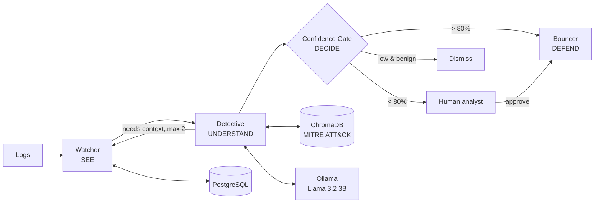

# Architecture

Source of truth: [PROJECT_PLAN.md](PROJECT_PLAN.md) and
[Project_Drishti_Architectural_Diagrams.pdf](Project_Drishti_Architectural_Diagrams.pdf).

## Pipeline

## Components

| Stage | Module | Role |
|---|---|---|
| Watcher | `backend/app/agents/watcher.py` | Rules + Isolation Forest, dedup, history from PostgreSQL |
| Detective | `backend/app/agents/detective.py` | MITRE RAG + LLM verdict as strict JSON |
| Confidence Gate | `backend/app/agents/confidence_gate.py` | Weighted score, routes auto / human / dismiss |
| Bouncer | `backend/app/agents/bouncer.py` | Executes mitigation through an adapter (simulated by default) |
| Orchestration | `backend/app/orchestration/` | LangGraph graph and shared `IncidentState` |

## Safety

Mitigation is simulated by default. Real adapters are disabled unless `MITIGATION_MODE=real`,
and localhost, the gateway and allowlisted IPs are never blocked.
